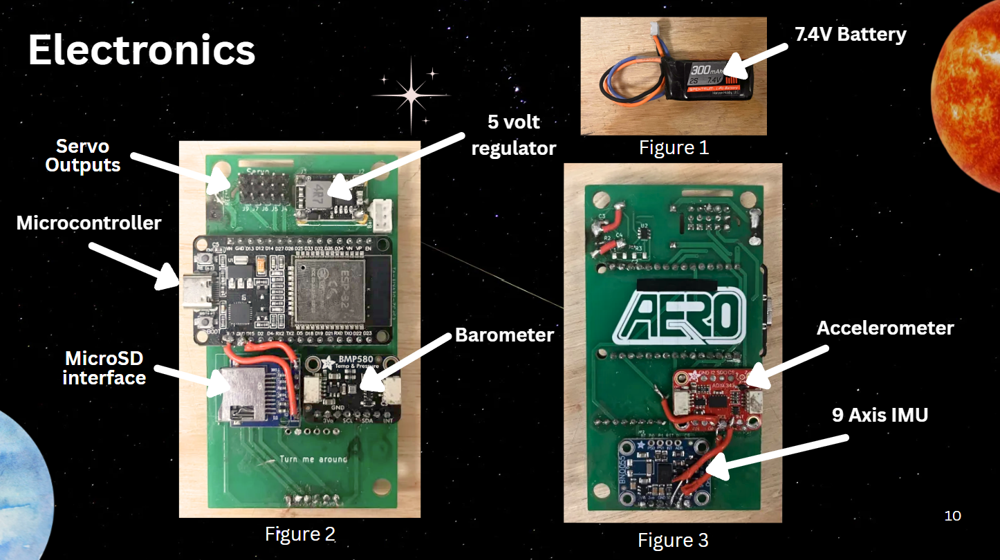
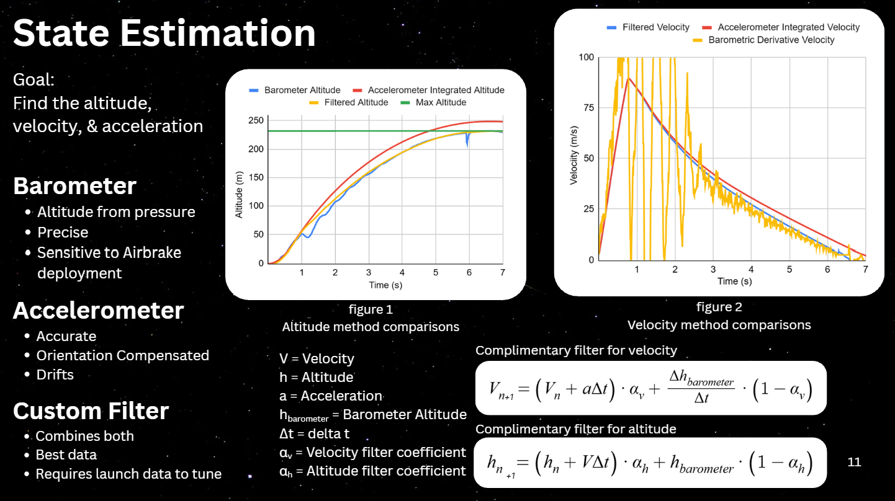
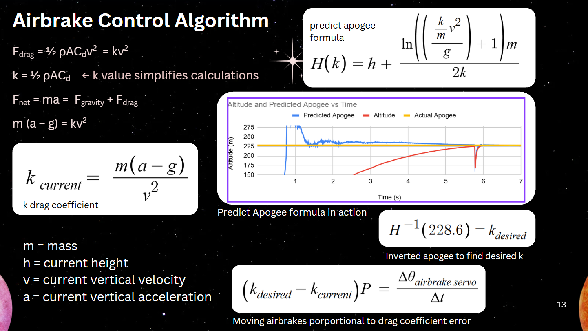
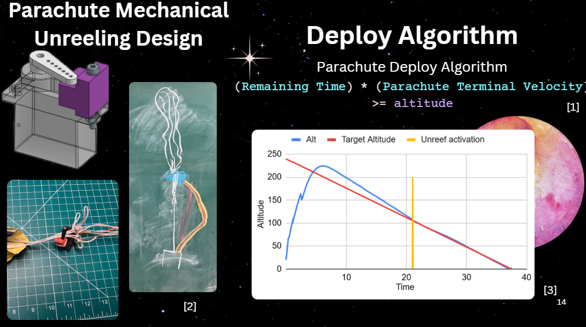

# Mower 8.0
## Introduction
Hi, I'm Tony, this is 8th iteration of the mower code. We call our code mower because our rocket's **mow the grass** (lawn dart).

featuring airbrakes, mechanical parachute deployment, and a camera system, the smart rocket actively tries to score better in the ARC (American Rocketry Challenge).

## Electronics
We wanted our electronics to have maximium functionality even if it seems  pointless. We choose the latest sensors on the market.

### Microprocessor
#### ESP32 
- boasting `240` mhz and `2` cores, we choose this microprocessor for it's esp32 speed and ease of use.
- The `wifi & bluetooth` components are unused as it triples compile times.
---
### Barometer
#### BMP581 
- `  < 1 meter` precision, `100+` hz.
- It's low latency is good for finding instentaneous velocity through derivative
- A current issue is that it seems to be a bit noisy and data is screwed with by the airbrakes
---

### 9axis IMU, Accelerometer, Gyroscope, and Magnometer
#### BNO085
- `+-8G` acceleration, `100+` hz
- Used to find orientation through sensor fusion
---

### Accelerometer
#### ADXL343 
- `+-16G` acceleration, `100+` hz
- Captures full range of rocket acceleration
- It's filtered **global vertical acceleration** is found through orientation compensation from the BNO085 
---

### SD CARD ADAPTER
- Generic micro sd card reader using SPI.
- Used to log flight data
- we give it 5volts as feeding it 3.3v is not stable (figured out after countless hours of trial and error)
---

### Battery
#### 7.4V 2S 600 mAH LIPO battery
- Very small battery to optimize weight
- ~1 hour battery life
- The electronics have no undervoltage protection so the battery will get destroyed if left on for too long 
- main limiting factor is the number of servos we use. 1S can support 1 servo, 2S can support atleast 5 servos.
---

### Actuation
#### mg90s Servos
- cheap, small, light
- decently powerful. More powerful than the mg90s
- fast actuation
- relatively minimal power consumption
- reliable so far (except for power issues)

## Code
every sensor/peripheral is it's own file for organization. The logic is split into flight states `0 through 5`

### SETUP
- intializes every subsystem, sensors, actuatiors, etc

### State 0
#### DEBUG
- the debug state unused for rocket launches,
- used to print data and other outputs
### State 1
#### LAUNCHPAD READY
- This state corresponds to the rocket on the launch pad awaiting detecting high acceleration or passing an altitude threshold
- Prevents junk data in the data files
- A rolling acceleromter zero is used to have a good altitude and velocity tare after the rocket launch
### State 2
#### THRUST STAGE
- This state corresponds to the rocket motor burn. This prevents the airbrakes from actuating
- In stage 2 & 3, the SD card does not open and close the file written. That's because writing the file halves the frequency of processing loop. We're essentially sacrificing data safety for `2-3x hz`.
### State 3
#### UPWARD COAST
- Standard ballistic trajectory territory.
- Airbrake algorithms are active in this stage to try and coast to the target altitude. *STUB*
- No SD card closing for maximium datarate

### State 4
#### DOWNWARD COAST
- Parachute deployment algorithm activates *STUB*
- opens and closes the data log every loop for safety. Less need for extremely realtime data

### Stage 5
#### On the ground
- no data logging, the rocket remains dossile

## ALGORITHMS
### Kalman Filter

Estimating the state of the rocket is required for active control. In order to guide the rocket to the target altitude, we first need find where it is.

Barometer:
In our first 2 launches, we relied mainly on a barometer for altitude and velocity. However, when airbrakes deploy, they cause a high-pressure region above where the sensors are, causing a corresponding dip in the altitude read (Fig. 1). 

Accelerometer:
In our next two launches, we relied on the accelerometer for velocity. While the velocity was smooth, it tended to drift over time as tiny errors compounded (Fig. 2). We tried to reduce the error by compensating for orientation, but this was only marginally helpful. From these early launches, we decided to implement a better filter for the data.

Custom Filter:
In our last 3 launches, we used a complimentary filter. By relying on an accelerometer integration while "spiking" the state with barometric datapoints, we could steer the state towards a global truth while still cashing in on the benefits of a smooth curve. The results can be seen on the graphs, resilience towards airbrake sensitivity and drift.

We validated filter coefficients through comparison to many previous telemetry logs.
### Predict Apogee & Control Loop

We developed a unique method to control the airbrakes.

Our algorithm only runs when the motor burns out as it is easier to predict the rocket while it coasts up. 
 
We start by finding the current drag coefficient with measured quantities. 

We then find the desired drag coefficient. This is the drag coefficient k that says: "If we want our rocket to reach the target apogee, what would our drag coefficient need to be?" To solve this question we inverted our predict apogee formula. Instead of predicting our apogee with a given drag coefficient and the rocket's current state, we find the drag coefficient required to reach a apogee of 750 feet or 228.6 meters. The predict apogee formula requires inputs of: k drag coefficient, mass, velocity, height, gravity. Then applying a binary search inverting the function finding the target drag coefficient. 

After finding the current and desired drag coefficients, if the desired drag is more than the current drag, we increase drag through the airbrakes and vice versa. This is done through a simple P controller. A bigger error in drag coefficient results in a bigger change in airbrake deployment.

### Parachute Deployment

Parachute Deploy Design:
- Reefs the parachute during initial descent.
- Small parachute hole stops the knots in the shroud from going through
- The servo wire is longer than the shroud and shock chord combined. All force is on shock cord

- Our failure points: putting the knots on the wrong side (force on servo not plastic), tangle the parachute during wrapping, the wire breaks (see qual 1).

Improvement plans:
- A variable tightening of the reefing so that we can change the diameter of the parachute's opening.

[1] Plot showing altitude over time, including:

1. Target altitude (red),

2. Actual altitude (blue), and

3. Parachute deployment indicator (yellow).
The grey line indicates zero altitude.

[1] The condition checks whether the remaining time multiplied by the parachute’s terminal velocity (m/s), exceeds the current altitude. This indicates that it is optimal to deploy right now to get close to the target time

Calculating remaining time in seconds and multiplying the remainder by Parachute Terminal Velocity (m/s) to estimate the distance the rocket would fall during that interval, allowing the system to determine whether parachute deployment would result in the best time.